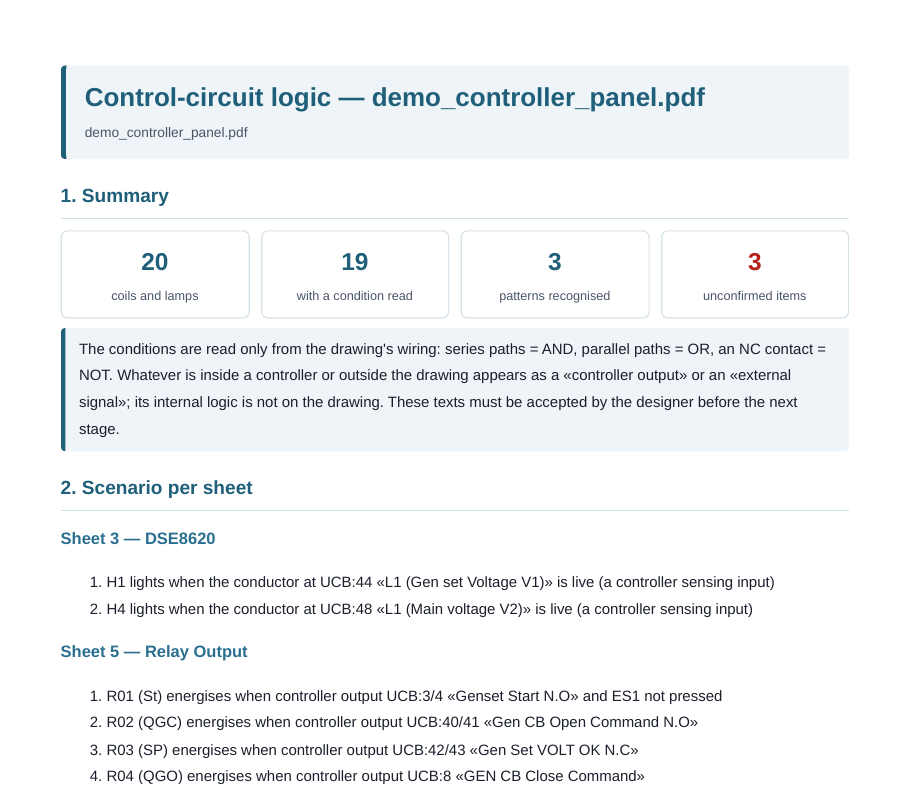
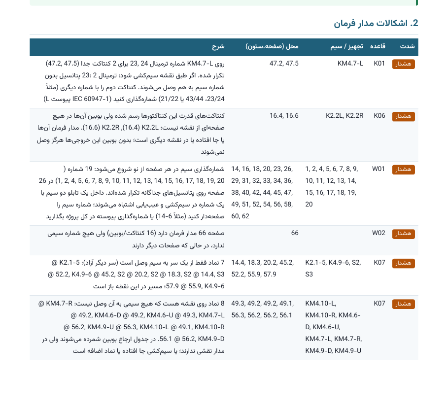
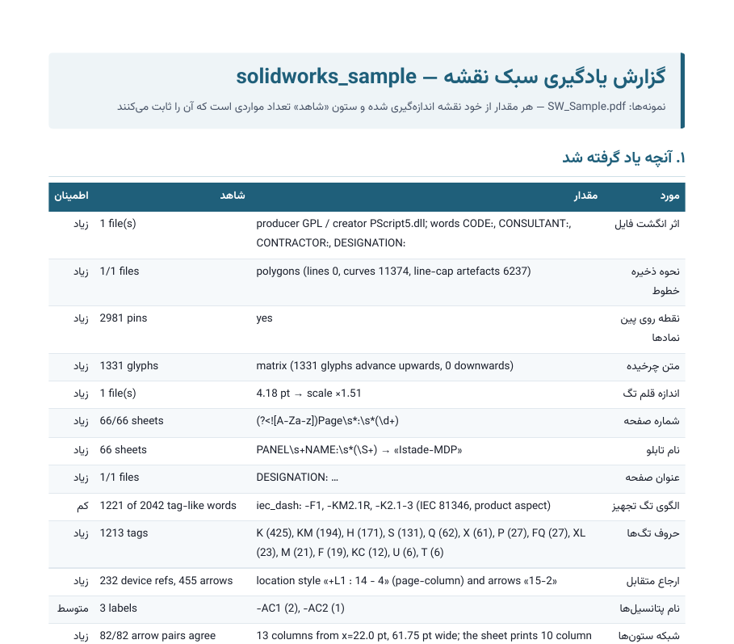
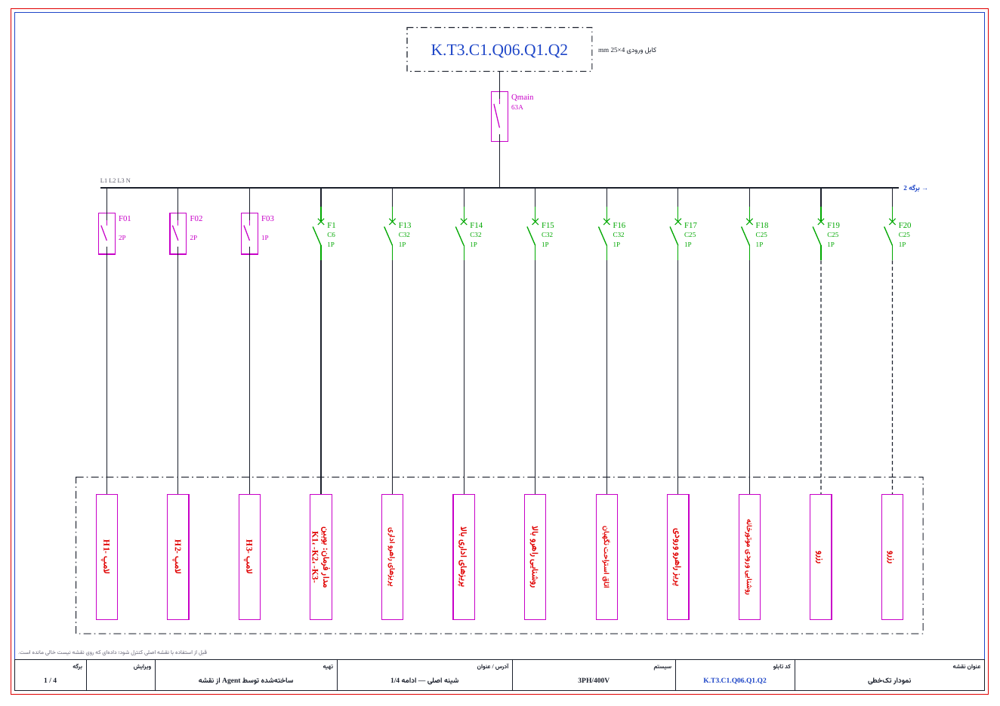
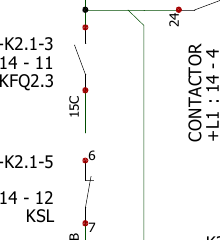

# EPLAN Fuse List Agent — showcase

**An AI-assisted design-review agent for electrical panel drawings.**
It reads vector PDF schematics (EPLAN Electric P8, SOLIDWORKS Electrical, and new drawing styles it
learns from a sample) and produces, without manual input:

| Output | What it contains |
|---|---|
| Fuse list (PDF + Excel) | every breaker and fuse with rating, consumer, supply path and phase |
| Drawing review | 40 design rules (IEC 60364, IEC 60898 / 60947, IEC 61082 documentation) |
| Control-circuit review | coils, contacts, interlocks, open wires, cross-reference errors, supply paths |
| Control-circuit logic | the boolean condition of every coil and lamp, recognised patterns, a scenario per sheet |
| Power calculations | short circuit (IEC 60909), fault loop (IEC 60364-4-41), voltage drop, PF correction |
| Single-line diagram | per panel and per project, drawn in a switchboard house style |
| Duct / device labels | one label per device, ready to print |

> The source code is not published. This repository shows what the agent does, with sample
> outputs on anonymised drawings (names, codes and dates removed). To see it run on **your**
> drawing, see *Try it* below.

## How it works (short)

1. **Reads the vectors, not an image** — every wire, symbol pin and text position from the PDF.
2. **Drawing-style profile** — how a CAD program writes lines, cross-references (`/5.E:4`,
   `05-5`), page arrows, title blocks and tags. A new style is *learned* from a sample drawing
   (`--learn`): every value is measured with its evidence, several reading options are tested on
   the drawing itself and scored by a self-check, and the report says what was not understood.
3. **Electrical graph** — nets across pages, devices from symbol shape and the text block next to
   the symbol (a «C6» trip curve, a «10×38» fuse size), supply rails, every load's path through
   fuses and contacts, controller terminals and their functions.
4. **Deterministic rules** — every finding points to a page/column and can be checked on the
   drawing; what cannot be decided with confidence is marked *operator must specify*. It runs
   fully offline. An optional local LLM only rewrites descriptions; it never decides a finding.

## Examples

| | |
|---|---|
|  |  |
| Fuse list of a generator-controller panel read through a **learned** drawing style — supply and consumer of every fuse, including the controller terminals it feeds | Control logic: what energises each relay, read from the wiring — e.g. `R01 = NOT ES1 AND UCB:3/4` |
|  |  |
| Patterns with evidence on three star-delta starters: self-hold, interlocks, emergency-stop chain | Control review of a 66-sheet MCC drawing (SOLIDWORKS Electrical) |
|  |  |
| Style-learning report: every learned value with its evidence | Single-line diagram in switchboard house style |
|  | |
| A finding: the wire stops 6.6 pt short of the contact pin — the coil circuit is open | |

## Sample reports (PDF)

| Report | File |
|---|---|
| Control-panel fuse list (learned drawing style) | [docs/samples/sample_fuse_list_controller_panel.pdf](docs/samples/sample_fuse_list_controller_panel.pdf) |
| Control-circuit review | [docs/samples/sample_control_review.pdf](docs/samples/sample_control_review.pdf) |
| Control-circuit logic — generator controller panel | [docs/samples/sample_control_logic_controller_panel.pdf](docs/samples/sample_control_logic_controller_panel.pdf) |
| Control-circuit logic — three star-delta starters | [docs/samples/sample_control_logic_star_delta.pdf](docs/samples/sample_control_logic_star_delta.pdf) |
| Style-learning report | [docs/samples/sample_style_learning_report.pdf](docs/samples/sample_style_learning_report.pdf) |

## Try it

Send a vector PDF (not a scan) and I run the agent on it and return the outputs — usually within
two working days. Drawings are processed offline on my own machine and deleted afterwards;
an NDA is fine. Contact: see my GitHub profile / LinkedIn.

## Author

Electrical design engineer (EPLAN P8, SOLIDWORKS Electrical, AutoCAD) — panel design, control
circuits, generator and MV systems — building AI agents for electrical design review.

---
© All rights reserved. The outputs shown here may not be reused without permission.
