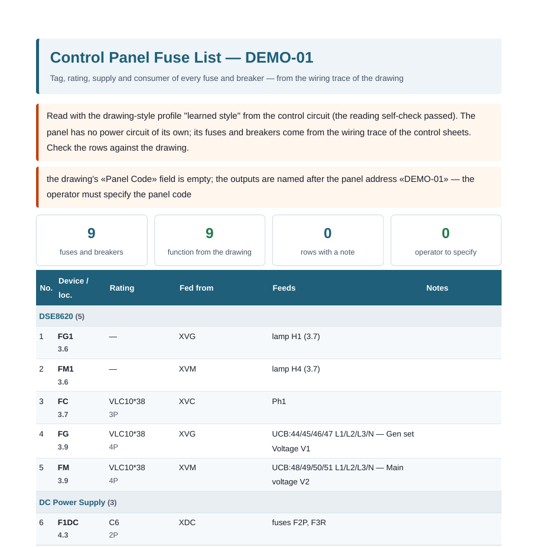
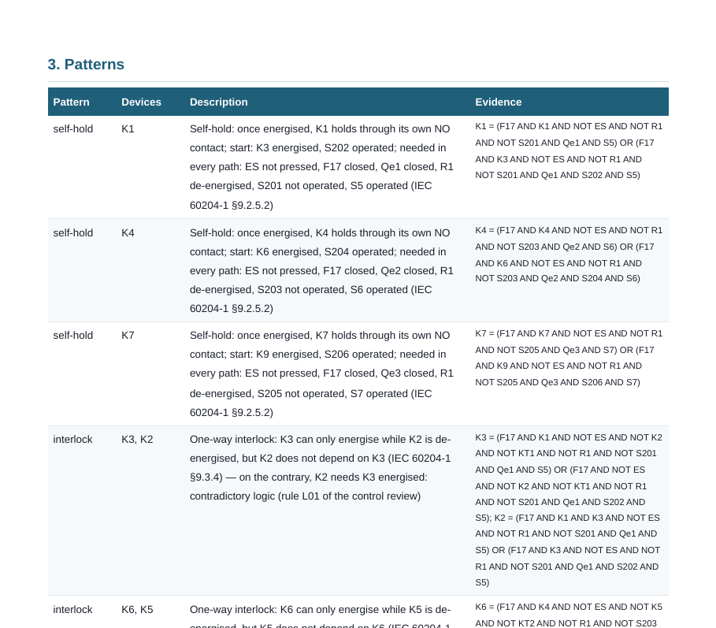
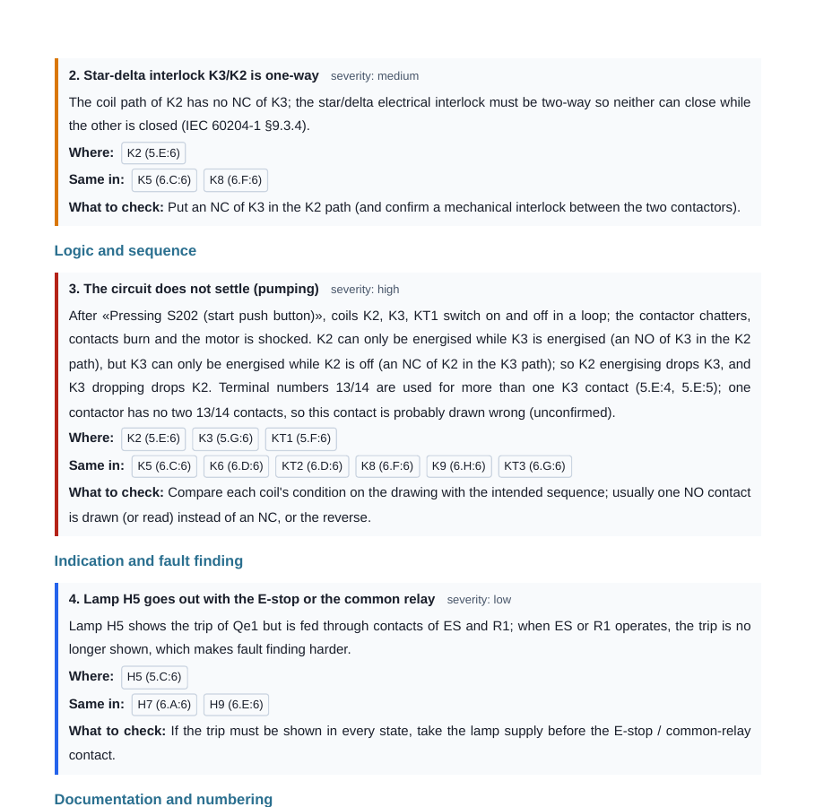
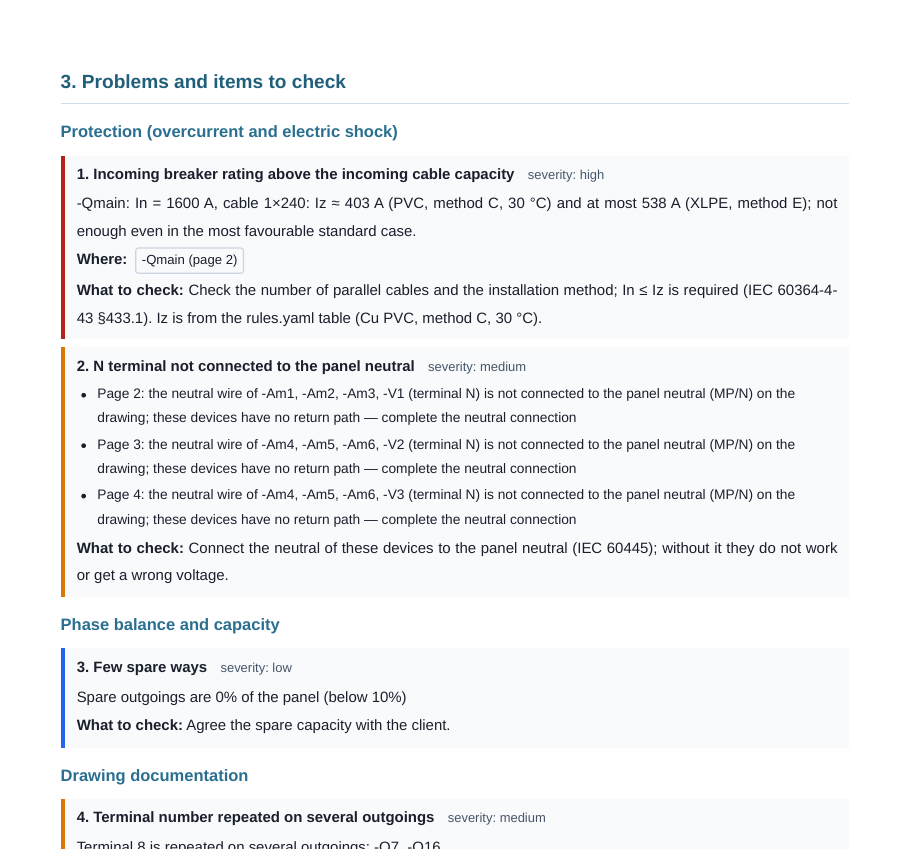
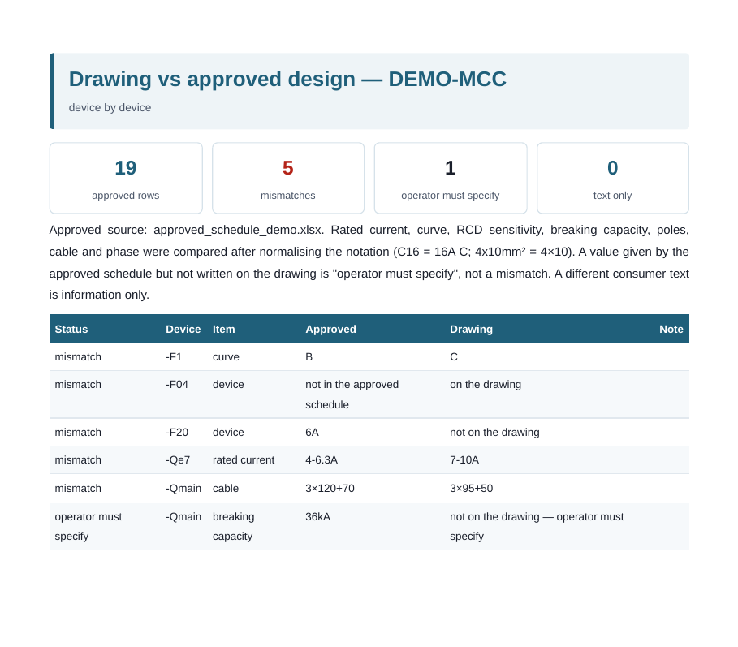
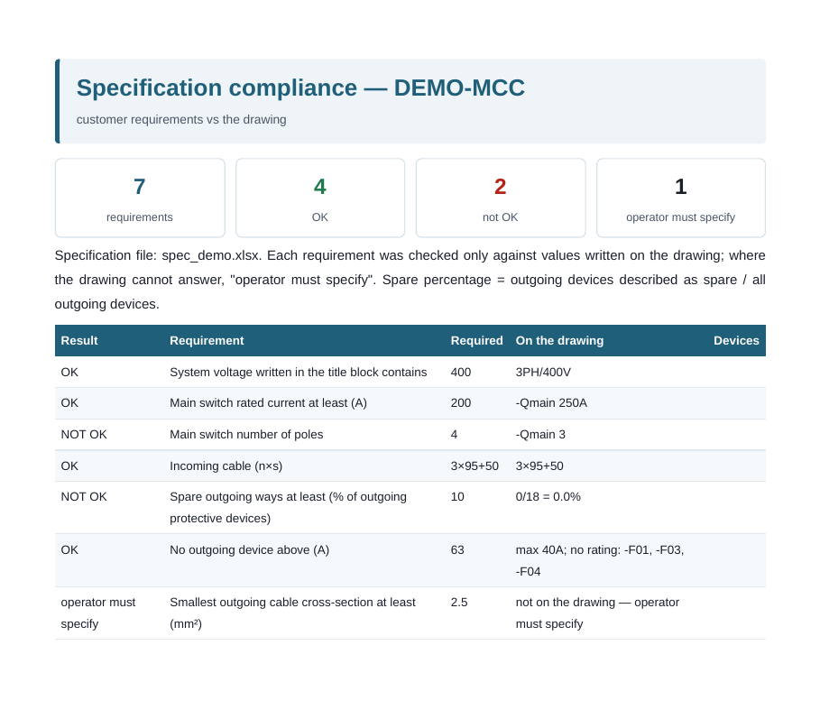
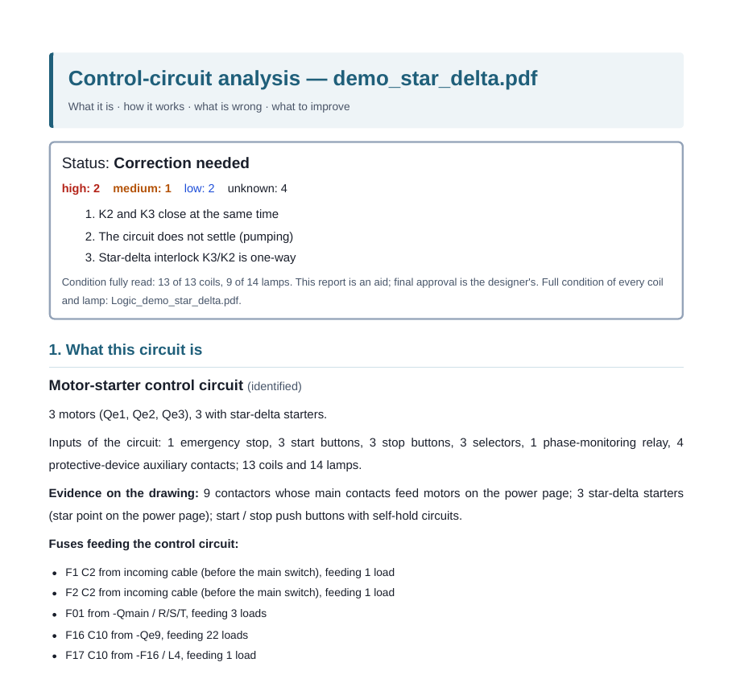
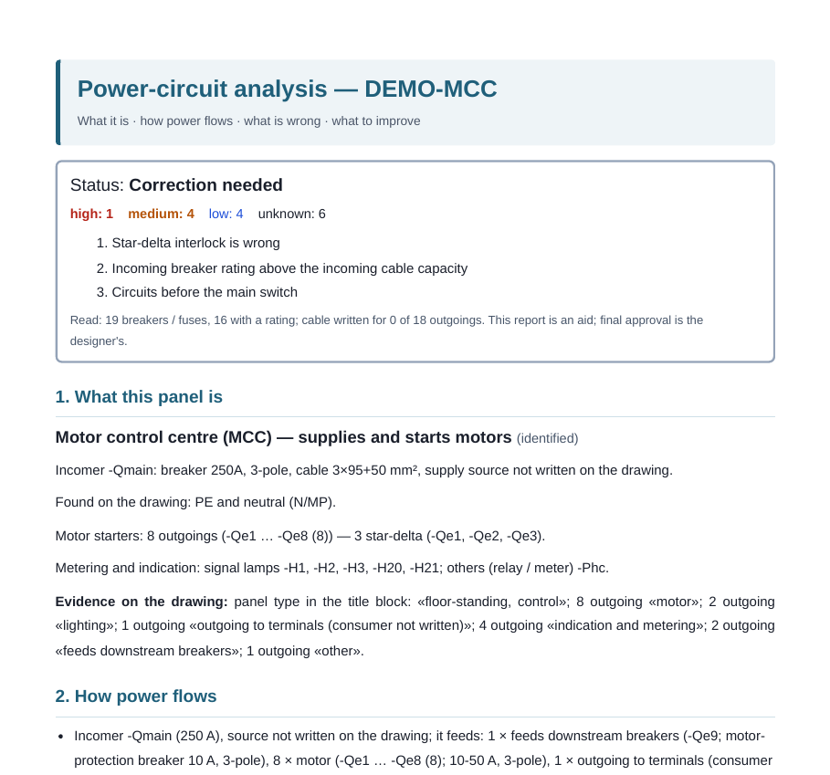

# Electrical Panel Analysis & Design Review Agent — showcase

**Author:** Yaser Alizadeh, electrical design engineer —
[LinkedIn](https://www.linkedin.com/in/yaser-alizadeh-electrical-designer) · y59933210@gmail.com

**An AI-assisted design-review agent for electrical panel drawings.**
It reads vector PDF schematics (EPLAN Electric P8, SOLIDWORKS Electrical, and new drawing styles it
learns from a sample) and produces, without manual input:

| Output | What it contains |
|---|---|
| Fuse list (PDF + Excel) | every breaker and fuse with rating, consumer, supply path and phase |
| Drawing review | 40 design rules (IEC 60364, IEC 60898 / 60947, IEC 61082 documentation) |
| Control-circuit review | coils, contacts, interlocks, open wires, cross-reference errors, supply paths |
| Control-circuit logic | the boolean condition of every coil and lamp, recognised patterns, a scenario per sheet |
| Power calculations | short circuit (IEC 60909), fault loop (IEC 60364-4-41), voltage drop, PF correction |
| Single-line diagram | per panel and per project, drawn in a switchboard house style |
| Duct / device labels | one label per device, ready to print |
| Control-circuit analysis **(new)** | what the circuit is, how it works step by step, what is wrong and how to fix it — with a status box on page 1 |
| Power-circuit analysis **(new)** | panel purpose with evidence, how power flows, breaker vs cable, protection and suggestions |
| Drawing vs approved design | current, curve, poles, cable and breaking capacity, device by device |
| Specification checklist | customer requirements checked against what the drawing actually states |

> The source code is not published. This repository shows what the agent does, with sample
> outputs on anonymised drawings (names, codes and dates removed). To see it run on **your**
> drawing, see *Try it* below.

## How it works (short)

1. **Reads the vectors, not an image** — every wire, symbol pin and text position from the PDF.
2. **Drawing-style profile** — how a CAD program writes lines, cross-references (`/5.E:4`,
   `05-5`), page arrows, title blocks and tags. A new style is *learned* from a sample drawing
   (`--learn`): every value is measured with its evidence, several reading options are tested on
   the drawing itself and scored by a self-check, and the report says what was not understood.
3. **Electrical graph** — nets across pages, devices from symbol shape and the text block next to
   the symbol (a «C6» trip curve, a «10×38» fuse size), supply rails, every load's path through
   fuses and contacts, controller terminals and their functions.
4. **Deterministic rules** — every finding points to a page/column and can be checked on the
   drawing; what cannot be decided with confidence is marked *operator must specify*. It runs
   fully offline. An optional local LLM only rewrites descriptions; it never decides a finding.

## New: analysis reports for the senior engineer

Each report opens with a **status box** — *Correction needed / Review needed / No serious problem found /
Incomplete analysis* — the number of findings by severity, the three most important ones, and how much of the
drawing was actually read. An incomplete reading is never reported as «no problem».

- **Control-circuit analysis** — recognises the circuit (motor starters, generator / mains changeover, …) with
  its evidence, simulates the relays and explains the sequence of operation with the contact that causes every
  change. Findings include two contactors closing at the same time, a circuit that does not settle (pumping),
  one-way interlocks and self-holds without a stop. Functions repeated on several starters are shown once as a
  common block. Paths that need one device to be in two states at once are removed before the analysis.
- **Power-circuit analysis** — states what the panel is (MCC, final distribution, distribution, capacitor bank,
  changeover) only when the drawing gives enough evidence, then follows the power from the incomer to every
  outgoing. Breaker rating is compared with the cable capacity for both PVC and XLPE installation; breaking
  capacity is checked only where it is written on the drawing; RCDs in series, sockets without RCD and missing
  earthing of surge arresters are reported. Suggestions give the smallest change that fixes the finding.

Examples from the sample reports below: a 1600 A incomer fed by one 240 mm² cable (Iz ≈ 403 A PVC / 538 A
XLPE — at least 4×240 mm² needed); measuring devices whose neutral is not connected to the panel neutral; the
star and delta contactors able to close together; a star-delta interlock wired in one direction only.

## From the drawing to the shop floor

Panel builders rarely lose time in design; they lose it between the drawing and the bench. Three checks
address that:

- **Connection list** — built only from the wiring drawn in the PDF. A wire with two ends is written
  «from → to»; where three or more ends share a potential, the members are listed but no bridging order is
  invented (a PDF does not carry it). Pins without a wire and duplicated terminal numbers are reported.
- **Drawing vs approved design** — against the approved fuse list (Excel/PDF) or a simple schedule, after
  normalising notation (C16 = 16A C; 4x10mm² = 4×10). A value the drawing does not state is
  *operator must specify*, never a guessed mismatch.
- **Specification checklist** — requirements as a short Excel checklist, each checked only against values
  written on the drawing.

Tested on 17 real drawings in two languages: existing outputs unchanged, repeated runs identical, deliberate
changes to an approved schedule found exactly.

## Examples

| | |
|---|---|
|  |  |
| Fuse list of a generator-controller panel read through a **learned** drawing style — supply and consumer of every fuse, including the controller terminals it feeds | Control logic: what energises each relay, read from the wiring — e.g. `R01 = NOT ES1 AND UCB:3/4` |
|  |  |
| Patterns with evidence on three star-delta starters: self-hold, interlocks, emergency-stop chain | Control-circuit review: verdict, findings by rule, every finding with page and column |
|  |  |
| Control-circuit analysis — findings: a one-way star-delta interlock and a circuit that pumps, each with the cause, the location and the fix | Power-circuit analysis of a 1600 A distribution board — findings: incomer breaker vs cable, neutral of the meters not connected |
|  | |
| Style-learning report: what the agent can produce with the learned style, and every learned value with its evidence | |
|  |  |
| Drawing vs approved design (demo schedule with deliberate changes) | Specification checklist: OK / not OK / operator must specify |
|  |  |
| **Control-circuit analysis** of three star-delta starters: status box, the circuit recognised with evidence, the fuses feeding the control circuit | **Power-circuit analysis** of the same motor-control panel: MCC identified with evidence, incomer breaker above the cable capacity |

## Sample reports (PDF)

| Report | File |
|---|---|
| Control-panel fuse list (learned drawing style) | [docs/samples/sample_fuse_list_controller_panel.pdf](docs/samples/sample_fuse_list_controller_panel.pdf) |
| Control-circuit review | [docs/samples/sample_control_review.pdf](docs/samples/sample_control_review.pdf) |
| Control-circuit logic — generator controller panel | [docs/samples/sample_control_logic_controller_panel.pdf](docs/samples/sample_control_logic_controller_panel.pdf) |
| Control-circuit logic — three star-delta starters | [docs/samples/sample_control_logic_star_delta.pdf](docs/samples/sample_control_logic_star_delta.pdf) |
| Style-learning report | [docs/samples/sample_style_learning_report.pdf](docs/samples/sample_style_learning_report.pdf) |
| **Control-circuit analysis — three star-delta starters** | [docs/samples/sample_control_analysis_star_delta.pdf](docs/samples/sample_control_analysis_star_delta.pdf) |
| **Control-circuit analysis — generator / mains changeover** | [docs/samples/sample_control_analysis_controller_panel.pdf](docs/samples/sample_control_analysis_controller_panel.pdf) |
| **Power-circuit analysis — motor-control centre** | [docs/samples/sample_power_analysis_mcc.pdf](docs/samples/sample_power_analysis_mcc.pdf) |
| **Power-circuit analysis — 1600 A distribution board** | [docs/samples/sample_power_analysis_distribution.pdf](docs/samples/sample_power_analysis_distribution.pdf) |
| Drawing vs approved design (demo schedule) | [docs/samples/sample_approved_design_check.pdf](docs/samples/sample_approved_design_check.pdf) |
| Specification checklist (demo requirements) | [docs/samples/sample_specification_check.pdf](docs/samples/sample_specification_check.pdf) |

## Try it

Send a vector PDF (not a scan) to y59933210@gmail.com, or write to me on
[LinkedIn](https://www.linkedin.com/in/yaser-alizadeh-electrical-designer). I run the agent on it and return the
outputs — usually within two working days. Drawings are processed offline on my own machine
and deleted afterwards; an NDA is fine.

## Author

Electrical design engineer (EPLAN P8, SOLIDWORKS Electrical, AutoCAD) — panel design, control
circuits, generator and MV systems — building AI agents for electrical design review.

- LinkedIn: <https://www.linkedin.com/in/yaser-alizadeh-electrical-designer>
- Email: y59933210@gmail.com

---
© All rights reserved. The outputs shown here may not be reused without permission.
